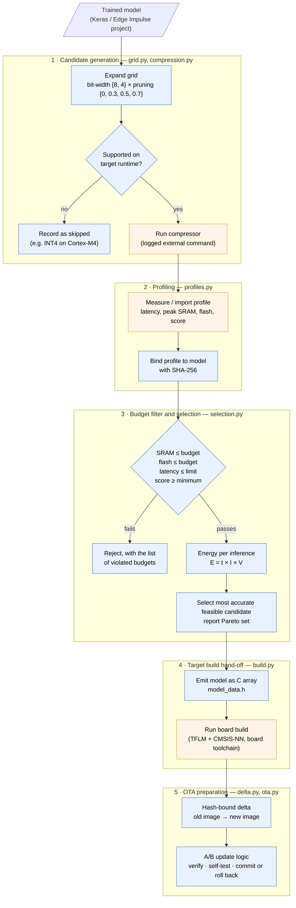
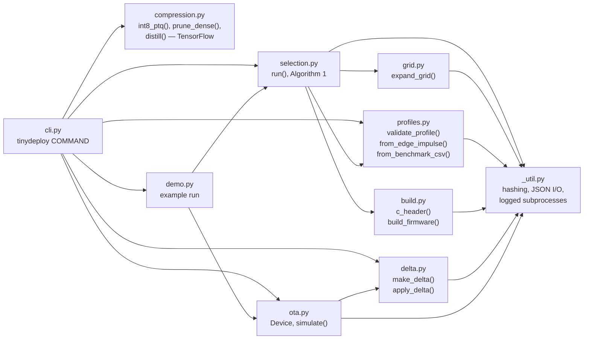
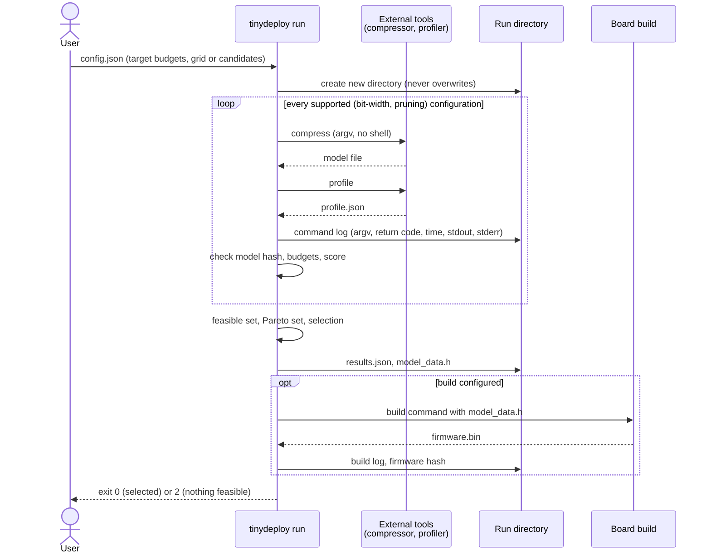
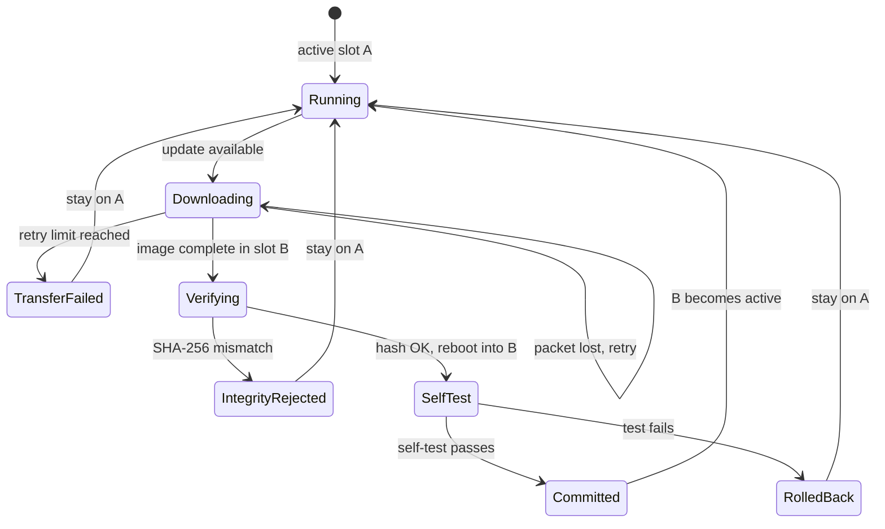

# TinyDeploy


TinyDeploy is a deployment workflow for fleets of microcontrollers (MCUs). It
takes a set of compressed model candidates, keeps the ones that fit a board's
memory and latency budget, picks the best one, hands it to the board's firmware
build, and prepares an over-the-air (OTA) update for the devices in the field.

TinyDeploy does **not** implement compression algorithms, inference kernels or
a bootloader. Those come from existing tools: Edge Impulse and its EON Tuner,
the TensorFlow Lite converter, TensorFlow Lite Micro (TFLM) and CMSIS-NN.
TinyDeploy is the orchestration between them, and it keeps a verifiable record
of every decision it makes.

It is the reference implementation of:

> J. ET-TOUSY, *TinyML for Resource-Constrained IoT Devices:
> Techniques, Benchmarks, and a Unified Deployment Framework*, 2026.

---

## Contents

- [Architecture](#architecture)
  - [Pipeline](#pipeline)
  - [Who does what](#who-does-what)
  - [Package structure](#package-structure)
  - [What happens during `tinydeploy run`](#what-happens-during-tinydeploy-run)
  - [OTA update logic](#ota-update-logic)
- [Installation](#installation)
- [Quick start](#quick-start)
- [Using TinyDeploy with your own models](#using-tinydeploy-with-your-own-models)
- [Command-line interface](#command-line-interface)
- [Configuration example](#configuration-example)
- [Outputs and the run record](#outputs-and-the-run-record)
- [Testing](#testing)
- [Repository layout](#repository-layout)
- [Mapping to the paper](#mapping-to-the-paper)
- [Scope and limitations](#scope-and-limitations)
- [Citation and license](#citation-and-license)

---

## Architecture

### Pipeline

The workflow has five stages. Each stage is a module in `src/tinydeploy/`, and
each one either calls an external tool or checks and records what that tool
produced.



Orange boxes are performed by external tools that TinyDeploy calls; blue boxes
are TinyDeploy's own logic.

### Who does what

| Stage | External tool | TinyDeploy |
|---|---|---|
| 1. Candidate generation | Edge Impulse / EON Tuner, or the TensorFlow Lite converter through the optional adapter | Grid expansion, support checks, logged compressor calls |
| 2. Profiling | Edge Impulse (build report, on-device runner) or on-board timing with `firmware/tinydeploy_benchmark.h` | Profile schema and validation, provenance, SHA-256 binding |
| 3. Filtering and selection | – | Budget filter, rejection reasons, energy estimate, Pareto set, selection |
| 4. Target build | TFLM, CMSIS-NN and the board toolchain (graph optimizations, kernels, arena planning) | C array emission, shell-free build call, build log, firmware size and hash |
| 5. OTA preparation | Radio stack and bootloader on the device | Delta codec, A/B update logic, fleet simulation and its logs |

The core needs only the Python standard library. TensorFlow is needed only for
the optional compression adapter (`tinydeploy compress`).

### Package structure



### What happens during `tinydeploy run`



### OTA update logic

Each device keeps two equal firmware slots. An update is written to the
inactive slot and only becomes active after its hash and a post-boot self-test
pass. On a device, the self-test runs a golden inference on a fixed test vector;
in the host simulator it is a supplied check function.



The fleet simulator (`tinydeploy simulate-ota`) runs this logic for many
devices with seeded packet loss, bounded retries and injected faults, in both
full-image and delta mode with identical random streams, and logs every event.

---

## Installation

Python 3.10 or later.

```bash
git clone <repository-url> tinydeploy
cd tinydeploy
python -m venv .venv && source .venv/bin/activate
pip install -e .                  # core (no dependencies)
pip install -e ".[tensorflow]"    # + INT8 PTQ / pruning / distillation adapter
pip install -e ".[notebook]"      # + walkthrough notebook
pip install -e ".[dev]"           # + pytest
```

Check the installation:

```bash
tinydeploy --version
```

## Quick start

```bash
tinydeploy demo example-output
```

This runs a small self-contained example of every stage in a few seconds:

| Part | What it shows | Output folder |
|---|---|---|
| Selection | Three candidates against a small target: two feasible, one rejected for SRAM and latency, Pareto set, C header | `example-output/selection/` |
| Algorithm 1 grid | Eight configurations; the four INT4 ones skipped as unsupported; compress and profile commands logged; best feasible candidate selected | `example-output/grid/` |
| OTA | 500 devices × 3 rounds, full image versus delta, with every event logged | `example-output/ota/` |

The example uses small generated byte strings instead of real models and
firmware, and its profiles are labelled `synthetic`. It shows how the software
behaves; it does not reproduce results from the paper.

For a guided tour with tables and plots, open
[`notebooks/tinydeploy_walkthrough.ipynb`](notebooks/tinydeploy_walkthrough.ipynb).

## Using TinyDeploy with your own models

A typical run with Edge Impulse and two boards:

1. **Train and compress** each candidate in Edge Impulse (or with
   `tinydeploy compress` for TensorFlow models).
2. **Measure** each candidate on the board, either with the Edge Impulse
   runner or with `firmware/tinydeploy_benchmark.h`
   (see [`docs/hardware-measurement.md`](docs/hardware-measurement.md)).
3. **Import** each result as a profile bound to its model file:

   ```bash
   tinydeploy import-profile edge-impulse report.json --model kws-int8.tflite \
       --target stm32l476 --metric accuracy --score 0.918 --output kws-int8.json

   tinydeploy import-profile benchmark timing.csv --model kws-int8.tflite \
       --target stm32l476 --metric accuracy --score 0.918 \
       --peak-sram 36864 --protocol protocol.json --output kws-int8.json
   ```

4. **Write one configuration per board** with its budgets and candidates (see
   [Configuration example](#configuration-example)).
5. **Select and build**:

   ```bash
   tinydeploy -v run stm32l476.json --output runs/stm32l476
   ```

6. **Prepare the OTA update** from the previous and the new firmware:

   ```bash
   tinydeploy delta old.bin runs/stm32l476/firmware.bin --output update.delta.json
   tinydeploy simulate-ota old.bin runs/stm32l476/firmware.bin --config fleet.json --output runs/ota
   ```

When a budget changes later, for example after a firmware update leaves less
SRAM for the model, edit the budget and repeat steps 5 and 6. The profiles are
reused.

## Command-line interface

| Command | Purpose |
|---|---|
| `tinydeploy run CONFIG --output DIR [--allow-synthetic]` | Generate or read candidates, check budgets, select, write `model_data.h`, optionally build firmware. Exit code 2 when nothing is feasible. |
| `tinydeploy import-profile edge-impulse REPORT --model M --target T --metric {accuracy,auc} --score S --output P [--engine {eon,tflite}]` | Convert an Edge Impulse profiling report into a profile. |
| `tinydeploy import-profile benchmark TIMING.csv --model M --target T --metric ... --score S --peak-sram B --protocol PROTOCOL.json --output P` | Convert on-board timing samples into a `measured` profile. |
| `tinydeploy delta OLD NEW --output DELTA` | Create a hash-bound delta. |
| `tinydeploy apply-delta OLD DELTA --output NEW` | Verify the base image, rebuild, verify the result. |
| `tinydeploy simulate-ota OLD NEW --config FLEET --output DIR` | Seeded A/B fleet simulation, full image versus delta. |
| `tinydeploy compress MODEL --data NPZ --output M.tflite [--prune R] [--teacher T --temperature 3 --alpha 0.5]` | INT8 PTQ with optional structured pruning and distillation (TensorFlow). |
| `tinydeploy demo DIR` | Self-contained example of all stages. |

Global options: `-v` / `-vv` print execution logs, `--log-file FILE` also
writes them to a file.

## Configuration example

One file describes one target. A grid configuration for an STM32L476-class
board:

```json
{
  "metric": "accuracy",
  "minimum_score": 0.88,
  "target": {
    "id": "stm32l476",
    "sram_bytes": 131072,
    "flash_bytes": 1048576,
    "firmware_reserve_bytes": 262144,
    "max_latency_ms": 100,
    "current_ma": 10,
    "voltage_v": 3.3,
    "supported_bit_widths": [8]
  },
  "grid": {
    "base_model": "model.keras",
    "bit_widths": [8, 4],
    "prune_ratios": [0, 0.3, 0.5, 0.7],
    "model_file": "{workdir}/model.tflite",
    "profile_file": "{workdir}/profile.json",
    "compress": ["tinydeploy", "compress", "{base_model}", "--data", "data.npz",
                 "--prune", "{prune}", "--output", "{model}"],
    "profile":  ["./profile.sh", "{model}", "{profile}"]
  },
  "build": {
    "command": ["make", "-C", "firmware", "MODEL_HEADER={model_header}"],
    "binary": "firmware/build/app.bin"
  }
}
```

Instead of `grid`, a `candidates` list can point to models and profiles that
already exist, for example Edge Impulse results imported with
`import-profile`. All keys and file formats are specified in
[`docs/formats.md`](docs/formats.md).

## Outputs and the run record

`tinydeploy run` writes a new directory and refuses to overwrite an existing
one:

```
runs/stm32l476/
├── config.json          copy of the configuration that was run
├── results.json         every candidate: values, energy, rejection reasons;
│                        skipped configurations; feasible and Pareto sets;
│                        selection; hashes of config, models and firmware
├── profiles/            archived profile of each candidate
├── logs/                one JSON log per external command
│                        (argv, return code, elapsed time, stdout, stderr),
│                        including build.json when a build is configured
├── selected_model.bin   the selected model file
├── model_data.h         selected model as a 16-byte-aligned C array
└── firmware.bin         firmware image, when a build is configured
```

A model whose SHA-256 does not match its profile is refused, so a profile can
never be applied to the wrong model. `simulate-ota` writes `events.jsonl` (one
line per update event) and `summary.json` (totals per mode and the model's
assumptions).

## Testing

```bash
pip install -e ".[dev]"
pytest
```

The suite covers the grid, profile validation and importers, the budget filter
and selection, the build hand-off, the delta codec, the A/B update logic and
the fleet simulator, plus end-to-end CLI runs. `tests/test_example_values.py`
checks that the seeded example still gives the same outcome. TensorFlow tests
run when TensorFlow is installed and are skipped otherwise. CI
(`.github/workflows/ci.yml`) runs the suite on Python 3.10–3.13 and the
TensorFlow adapter tests separately.

## Repository layout

```
tinydeploy/
├── src/tinydeploy/
│   ├── cli.py            command-line interface
│   ├── selection.py      run pipeline, budget filter, Pareto set, selection
│   ├── grid.py           Algorithm 1 grid and support checks
│   ├── profiles.py       profile schema, Edge Impulse and benchmark importers
│   ├── build.py          C array emission and board build hand-off
│   ├── delta.py          hash-bound delta codec
│   ├── ota.py            A/B update logic and fleet simulation
│   ├── compression.py    optional TensorFlow adapter (PTQ, pruning, KD)
│   ├── demo.py           self-contained example
│   ├── _demo_adapter.py  stand-in compressor/profiler used by the example
│   └── _util.py          hashing, JSON I/O, validation, logged subprocesses
├── tests/                pytest suite
├── docs/
│   ├── architecture.md          stages, responsibilities, selection rule
│   ├── formats.md               every input and output file format
│   └── hardware-measurement.md  on-board timing protocol
├── firmware/
│   └── tinydeploy_benchmark.h   on-board latency benchmark helper (C)
├── notebooks/
│   └── tinydeploy_walkthrough.ipynb
├── scripts/
│   └── measure_overhead.py      host-side overhead of TinyDeploy itself
├── .github/workflows/ci.yml
├── pyproject.toml
├── CITATION.cff
└── LICENSE
```

## Mapping to the paper

| Paper | Code |
|---|---|
| Fig. 1, Section IV – pipeline stages | `selection.run` orchestrating `grid`, `profiles`, `build` |
| Table II – module interfaces and responsibility boundaries | [Who does what](#who-does-what), [`docs/architecture.md`](docs/architecture.md) |
| Algorithm 1 – constraint-based candidate selection | `grid.expand_grid`, `selection.rejection_reasons`, `selection.select` |
| Energy per inference, E = t × I × V | `selection.energy_uj` |
| Section IV-A – inputs, outputs, run record, hash binding | `selection.run`, `profiles.validate_profile`, [`docs/formats.md`](docs/formats.md) |
| Section III-A – distillation settings (T = 3, equal loss weights) | `compression.distill`, defaults of `tinydeploy compress` |
| OTA scheduler – A/B slots, SHA-256, self-test, rollback, delta | `ota.Device`, `delta`, `ota.simulate` |
| Section V-B – on-device latency measurement | `profiles.from_benchmark_csv`, `firmware/tinydeploy_benchmark.h` |
| Section V-G, Table VII – comparison with a manual workflow | the steps of [Using TinyDeploy with your own models](#using-tinydeploy-with-your-own-models) |

## Scope and limitations

- TinyDeploy runs on the host. The OTA part implements and simulates the A/B
  update logic; it is not bootloader firmware. Its energy model counts radio
  airtime only, and its assumptions are listed in every `summary.json`.
- Compression, profiling and inference kernels are delegated to the tools named
  above. The built-in TensorFlow pruning supports Dense-only `Sequential`
  models; CNN pruning, INT4 kernels and NAS are not implemented.
- One configuration file describes one target; a fleet with several board types
  uses one configuration per board.

## Citation and license

If you use TinyDeploy, please cite the paper above; see
[`CITATION.cff`](CITATION.cff). Released under the [MIT License](LICENSE).
